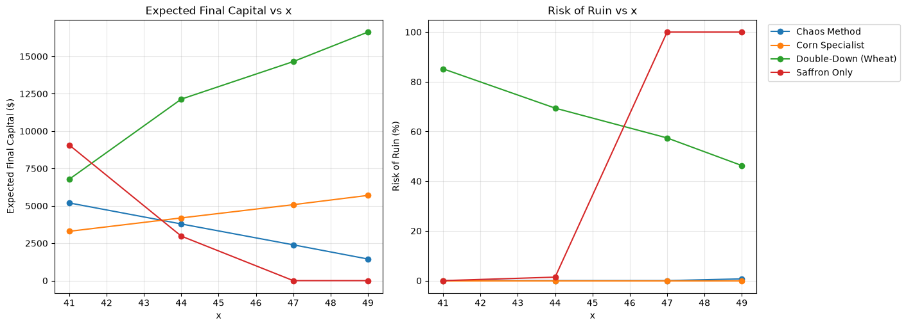

# Monte Carlo Evaluation of Crop Strategies

A Monte Carlo simulation comparing four betting strategies for a farmer who starts with $1000 and stakes money on one crop each season. It measures expected return, the median outcome and the risk of going broke. It also shows why a high average return doesn't make a strategy safe.

## The setup

Each season the farmer stakes $10 (or more, for Double-Down) on one crop. How likely each crop is to succeed depends on a parameter `x` between 40 and 50:

| Crop | Success probability | Payout on success |
|---|---|---|
| Corn | x% | 3x the stake |
| Wheat | x% | 3x the stake |
| Saffron | (100 - 2x)% | 10x the stake |

| Strategy | Rule |
|---|---|
| Corn Specialist | Always plant corn with a $10 stake |
| Double-Down (Wheat) | Always plant wheat. Double the stake after a loss, go back to $10 after a win |
| Saffron Only | Always plant saffron with a $10 stake |
| Chaos Method | Pick a crop uniformly at random each season |

Each strategy is run for 1000 seasons, 1000 times, at `x = 41, 44, 47, 49`. That's 16 million simulated seasons in total.

## Results



| Strategy | Mean final capital (x = 41 to 49) | Risk of ruin (x = 41 to 49) |
|---|---|---|
| Corn Specialist | $3,298 to $5,700 | 0% at every x |
| Chaos Method | $5,197 to $1,445 | 0% to 0.7% |
| Saffron Only | $9,070 to $0 | 0% to 100% |
| Double-Down (Wheat) | $6,782 to $16,625 | 85% to 46% |

- **Double-Down** has the highest mean, but its median is $0 for most values of `x`: the typical run goes broke, and a few lucky runs pull the average up.
- **Saffron** has a positive expected value only while `x < 45`. Above that, Saffron Only ends at $0 in every run.
- **Corn Specialist** never went broke in any of the 4,000 runs and grows steadily, so it's the best choice for a risk-averse farmer.

The notebook works out the expected value of each bet, shows the distribution of final capital, and discusses the results in full.

## Running it

```sh
pip install -r requirements.txt
jupyter notebook crop_strategies.ipynb
```

The random seed is fixed, so every run gives the same numbers. A full run takes about 30 seconds.
